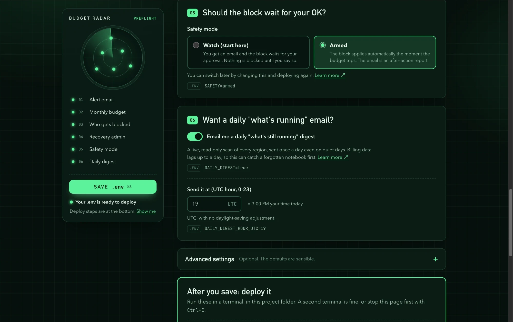
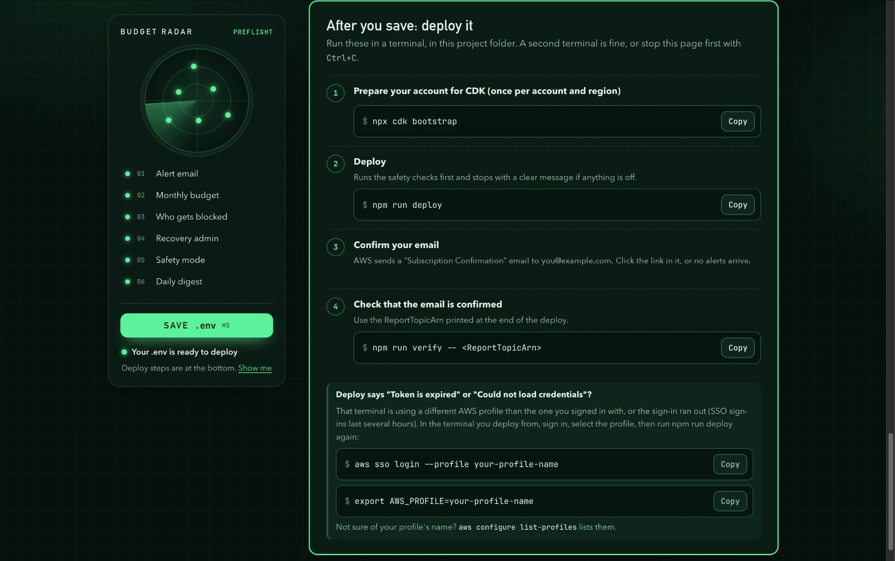

# AWS Budget Radar

A safety net for your personal AWS learning account. You set a monthly
budget. If your spending crosses it, Budget Radar:

1. **Blocks new spending.** Your everyday AWS identity can't launch or start
   the expensive stuff (EC2, RDS, SageMaker, and so on) until you lift the
   block.
2. **Emails you what's still running**, region by region, so you know exactly
   what to turn off.

You can also get a daily "what's still running" email, and have AWS stop
specific EC2/RDS instances you name. It costs (almost) nothing to run.

> **Know the limits**
>
> - **It's not a hard spending cap.** AWS billing data lags 8 to 12 hours, so
>   charges can pass your line before the alert fires, and keep growing after.
> - **It doesn't turn things off for you** (unless you list specific
>   instances). The email tells you what's running; you shut it down.
> - **It only restrains the identities you list.** The root user and anything
>   you didn't list are unaffected. It's a seatbelt, not a security boundary.
> - **Some services aren't scanned:** EKS, OpenSearch, ElastiCache, Savings
>   Plans/RI commitments, and data transfer.

## Getting started

| Step | What you do | You're done when |
|---|---|---|
| 1 | [Create a learning IAM user](#1-create-a-learning-iam-user) and work as it | You use that user day to day |
| 2 | [Install Node.js and the AWS CLI](#2-install-the-tools) | `node -v` and `aws sts get-caller-identity` both work |
| 3 | [Run `npm run setup` and fill in the page](#3-set-it-up) | The page says **Ready to deploy** |
| 4 | [Deploy and confirm your email](#4-deploy) | `npm run verify` shows nothing pending |

Then let it sit. [When your budget trips](#when-your-budget-trips) explains
what to do if you ever get the email.

## 1. Create a learning IAM user

The block can only attach to IAM **users, groups, or roles**. It can't touch
the root user or Identity Center (SSO) sign-ins. A new AWS account often has
no IAM user at all, and if you do your daily work as root or as your SSO
admin, **Budget Radar protects nothing.**

1. Sign in as root (or your admin), go to **IAM → Users → Create user**, and
   name it something like `learning`.
2. Choose **Attach policies directly** and attach **`AdministratorAccess`**.
3. **Do your normal AWS work as that user** from now on, in the console and
   the CLI.
4. Keep a **separate admin** that is *not* blocked, such as your SSO admin
   or a second IAM admin user (the root user can't be used for this). That's
   your **recovery admin**: you deploy Radar as it, and it lifts the block
   later.

The learning user is an admin, so it *could* remove the block from itself.
That's fine: this prevents accidents, it doesn't lock you out.

## 2. Install the tools

- **Node.js 20 or newer.** Check with `node -v`.
- **AWS CLI v2**, signed in to your account: `aws configure` for access keys,
  or `aws configure sso` and then `aws sso login --profile <name>` for SSO.
  `aws sts get-caller-identity` should print your account number.

## 3. Set it up

```bash
git clone https://github.com/AWS-SBG-at-the-University-of-Kentucky/AWS_Budget_Radar.git
cd AWS_Budget_Radar
npm run setup
```

`npm run setup` checks your Node version, installs dependencies, creates your
`.env` config file (it never overwrites one you already have), and opens the
setup page in your browser. If it doesn't open, copy the private link it prints.



- **Answer the questions.** Each one shows the exact `.env` line it writes.
- **Let AWS fill in the hard parts.** The page finds the AWS accounts you're
  signed in to on this computer (read-only, free). Pick the one to protect,
  and it lists your IAM users and fills in your recovery admin's ARN.
- **Start in Watch mode.** The block waits for your OK, so nothing is blocked
  until you approve it. You can switch to Armed later.
- **Click Save** (or press Ctrl+S / ⌘S). The page checks your answers with the
  same rules the deploy uses, and says **Ready to deploy** when nothing is
  missing.

Come back any time with `npm run dev`. The page only runs on your computer and
never deploys anything. Prefer a text editor? `.env` is plain text, and
[every setting is explained here](docs/reference.md#settings).

## 4. Deploy

The bottom of the setup page lists these steps, ready to copy:



1. **If you use a named AWS profile** (common with SSO), select it in the
   terminal you deploy from. The setup page shows the name it found.

   ```bash
   export AWS_PROFILE=<your-profile>
   ```

2. **Prepare your account for CDK**, once per account and region:

   ```bash
   npx cdk bootstrap
   ```

3. **Deploy:**

   ```bash
   npm run deploy
   ```

   This runs read-only safety checks first and stops with a plain-English
   reason if something is wrong (a typo'd user, a bad ARN, a budget that's
   already over). Fix it and run it again. Don't use `npx cdk deploy`
   directly; it skips the checks. You're done when you see
   `Preflight passed.` and then `✅ BudgetRadarStack`.

4. **Confirm your email.** AWS sends an email titled *"AWS Notification -
   Subscription Confirmation."* Click the link in it (check spam). Until you
   do, alert emails go nowhere.

5. **Check it worked**, using the `ReportTopicArn` printed at the end of the
   deploy:

   ```bash
   npm run verify -- <ReportTopicArn>
   ```

   No `PendingConfirmation` means you're done. Now let it sit.

## When your budget trips

AWS checks budgets a few times a day, so the email arrives up to about half a
day after the spending. It lists everything running and everything still
costing you money, region by region. What happens next depends on your safety
mode:

| | Watch (default) | Armed |
|---|---|---|
| When the budget trips | Nothing is blocked yet. The email has the approve command. | The block applies automatically. The email reports it. |
| If you ignore the email | Nothing is ever blocked | The block stays until next month, or until you lift it |

**To lift the block**, either wait for the next budget month (it clears by
itself), or run the reverse command from the email as your recovery admin.
The email fills in the values:

```bash
aws budgets execute-budget-action \
  --account-id <ACCOUNT_ID> --budget-name <BUDGET_NAME> --action-id <ACTION_ID> \
  --execution-type REVERSE_BUDGET_ACTION
```

Lifting the block doesn't restart anything you stopped.

**Don't press Reset mid-month.** If you're still over the line, AWS fires the
block again on its next check. Reverse only, or
[raise the threshold first](docs/reference.md#re-arming-mid-month-dont-just-press-reset).

**To switch modes**, change Safety mode on the setup page and run
`npm run deploy` again. Try one real trip in Watch mode before choosing Armed.

## Removing Budget Radar

Order matters. If the block is still attached when you run `cdk destroy`,
the stack can't delete it, and the command to lift it is already gone.

1. **Lift the block** if it's applied (see above), or wait for the month to
   end.
2. **Check it's gone.** This should list nothing named `DenyNewSpend` (use
   `list-attached-group-policies` or `list-attached-role-policies` for groups
   and roles):

   ```bash
   aws iam list-attached-user-policies --user-name <your-learning-user>
   ```

3. **Remove the stack:**

   ```bash
   npx cdk destroy
   ```

If `cdk destroy` already failed on `DeleteManagedPolicy`, detach the policy
by hand (use `detach-group-policy` or `detach-role-policy` for groups and
roles), then run destroy again:

```bash
aws iam detach-user-policy --user-name <name> --policy-arn <DenyNewSpendPolicyArn>
```

If you set up instance stop actions, check your EC2/RDS instances yourself
afterwards and start them as your recovery admin if needed. Removing the stack
isn't guaranteed to restart them.

## Troubleshooting

**The deploy check refused to deploy.** That's it working. Its message names
the exact problem. Fix that one thing and run `npm run deploy` again.

**Deploy says "Token is expired" or "Could not load credentials."** Your
terminal is using a different AWS profile than the one you signed in with
(with no `AWS_PROFILE` set, it uses `default`), or your sign-in expired. In
the same terminal (`aws configure list-profiles` shows the names):

```bash
aws sso login --profile <your-profile>
export AWS_PROFILE=<your-profile>
npm run deploy
```

**The budget tripped but no email came** (after about 12 hours). Run
`npm run verify -- <ReportTopicArn>`. An unconfirmed email subscription is
the usual cause, so click the confirmation email.

[More troubleshooting](docs/reference.md#troubleshooting)

## Learn more

The [reference guide](docs/reference.md) covers how it works, every setting,
exactly what the block stops (and what it doesn't), the daily digest,
stopping specific instances, what the report covers, and what Radar itself
costs. Maintainers: see [`RELEASE.md`](./RELEASE.md) for live-account testing
rules.
